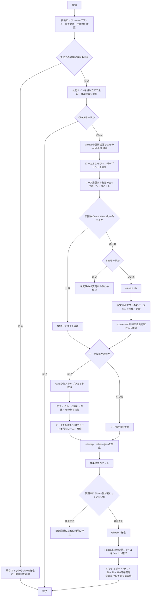

# 日常保守マニュアル

日々のデータ更新、サイト修正、同期、障害対応の手順です。新しいPCの準備は[PC移行マニュアル](PC_MIGRATION_GUIDE.md)、担当者交代は[継承者マニュアル](SUCCESSOR_GUIDE.md)、集計・画面の保守は[ダッシュボードマニュアル](DASHBOARD_GUIDE.md)を参照してください。

[マニュアルの入口](README.md)では、概要から新PC設定・シート編集・公開・譜例・復旧へ順に進めます。本書は日常更新・同期モード・復旧の正本です。譜例追加の仕様は[譜例トークン](SCORE_EXAMPLE_TOKENS.md)に集約しています。

## 1. 日常の作業

**前提：** 権限・PC設定が完了し、編集する正本と公開してよい範囲が決まっていること。

1. スプレッドシートの用語・訳語など、修正する元データを編集し、保存値・使用箇所・数式・日英の対応を読み直します。列契約は第2章を参照します。
2. プロジェクト直下で下記のGit確認を行い、main・origin・変更内容を確認します。他担当の同期、merge/rebase等の未完了操作がないことも確認します。同期は許可対象の未コミット文書等もまとめてコミットするため、別作業を混在させません。
3. シート更新を反映する場合は`.\sync-data.ps1 -Mode Data`を実行します。これは必要なGAS更新、commit、push、Pages公開確認までを含む本番操作です。サイト修正だけの場合は第2章のモードを選びます。
4. 「同期完了」、対象コミットのPages成功、公開ファイル一致、必要なAPI検査の成功を確認します。管理者モードの日英画面で修正箇所・通常検索・辞書実例を確認します。push成功だけでは公開完了ではありません。

```powershell
git rev-parse --show-toplevel
git branch --show-current
git remote -v
git status --short
git diff --stat
git diff --cached --stat
```

**成功の目印：** 元データと公開結果が一致し、必要な自動検査が完了。**次：** 通常運用へ。失敗したら第2章のトラブルシューティング、譜例を追加する場合は[譜例トークン](SCORE_EXAMPLE_TOKENS.md)へ進みます。

管理者自身の閲覧を計測から除外する設定は第5章にまとめています。

ダッシュボードAPIの認証移行では、専用 `DASHBOARD_API_TOKEN` の非公開設定とSitesプロキシの先行公開が一度だけ必要です。GASだけを先に公開しないでください。[ダッシュボードマニュアル](DASHBOARD_GUIDE.md)の初回移行手順を参照してください。`-Mode Check` はこの本番移行や公開を行いません。

### 公開リクエストの保存と受付上限

検索履歴・未登録語観測と、その語を移す判定・候補・語形対応の書込みは、先頭の空白等に続く `=`、`+`、`-`、`@` を文字列として保存します。検索語自体や検索結果の表示を変更せず、既存行の一括変換もしません。

検索通知と未登録語観測は、それぞれサイト全体で毎分30件・日本時間の日付ごとに3000件までです。通知メールは全体で毎分10件・同日80件までとし、GASのメール送信残枠が10件以下ならメールだけを止め、履歴の保存は継続します。受付上限に達した通知・観測は `recorded:false, limited:true` で返し、検索結果の表示は継続します。受付できなかった分を後から再送・補完しません。

カウンターはスクリプトプロパティの `public_request_budget_v1_notification`、`public_request_budget_v1_observation`、`public_request_budget_v1_mail` に件数と時間区分だけを保存し、同じスクリプトロック内で更新します。キャッシュ消失やUser-Agent・イベントIDの変更では上限をリセットできません。カウンターを読めない・保存できない場合は、上限なしの書込みに切り替えず停止します。予約後の失敗も受付数に含めます。手動でのカウンター削除は通常運用では不要です。

同じ検索内容の5秒以内の重複判定ではUser-Agentを識別に使いません。異なる検索や日英の検索は別内容として扱います。同じ内容を複数端末から同時に送った場合は通知・履歴がまとめられる場合があります。これらはシート書込み・メール送信の上限であり、GASへのHTTP呼出し自体や実行枠の消費を完全に防ぐ仕組みではありません。

## 2. データ同期ワークフロー

スプレッドシートから最新データを反映したり、プログラムを更新した場合は、同期スクリプトを使用します。

### 2-1. 同期スクリプトの実行方法
PowerShellから目的に合うモードで実行します。`02_RUN_SYNC.bat`はAutoを呼ぶ入口であり、シートの編集を必ず取得する専用入口ではありません。
```powershell
# シート更新を取得して公開（自動コミット・push・必要なGAS更新を含む）
.\sync-data.ps1 -Mode Data

# ローカル変更から自動選択する通常実行
.\sync-data.ps1

# シート更新に任意のコミットメッセージを指定
.\sync-data.ps1 -Mode Data -message "用語と訳語の更新"
```

### 2-2. 実行される処理の流れ

選択したモードの一回実行で最後まで自動で進みます。シート更新を含む場合はData、ローカル変更からの自動選択はAutoです。ブラウザーでの手動確認操作は不要で、ターミナル上に詳細な進捗がカラー表示されます。

分岐を含むフローチャートは本書の付録を参照してください。

1. main・未完了Git操作・変更パス・生成物の手動変更を確認します。自動マージ、自動退避、生成物の自動破棄は行いません。
2. ブラウザー用コードを組み立て、楽譜情報を自動コピーし、JS/CSSの内容ハッシュを各画面に付けます。既存テストと同期の安全性テストを実行します。
3. GitHub認証と公開設定、GAS編集版HEADと同期元の整合を確認し、ソース変更があればローカルにコミットします。リモートに未取得の変更やHEADだけの未統合ファイルがある場合は、コミット・本番変更前に停止します。
4. GASコードの更新が必要な場合、固定デプロイを更新し、埋め込まれたソースハッシュを確認します。同じコードであればGASの版を追加しません。
5. GASから生成結果を受け取り、実行ID、ソースハッシュ、必須ファイル・列、件数減少、全48実例ファイルと元データの対応を検証します。GASはGitHubへ書き込みません。GitHub認証をGASに送る処理もありません。
6. 全検証に成功してからローカルの生成物を更新し、sitemapと公開ファイルのハッシュ一覧を作成します。
7. 成果物をコミットし、GitHubへ送信します。
8. GitHubへの送信後、最終コミットのPages成功、公開HTML/JS/CSS/JSONの内容一致、ダッシュボードAPI（7/30/90/180日）を確認して完了します。

#### 更新範囲と確認用モード

| コマンド | 動作 |
| --- | --- |
| `.\sync-data.ps1` | 自動選択。変更なしならシートデータ更新。サイトだけの変更では不要なGAS更新・データ生成を省略 |
| `.\sync-data.ps1 -Mode All` | GASの内容を確認し、データも更新。変更のないGASの版は増やさない |
| `.\sync-data.ps1 -Mode Data` | データ更新。必要なGASコード更新も自動実施 |
| `.\sync-data.ps1 -Mode Site` | サイト更新。GASに未反映の変更がある場合は停止 |
| `.\sync-data.ps1 -Mode Check` | ローカルの組み立て・検証のみ。本番変更なし |
| `.\sync-data.ps1 -Mode Verify` | 未完了の公開・確認を再開。既存コミットのpushを含み得る。新しい版やコミット・データ取得は行わない |
| `node scripts/preview-site.js --open` | 現在のローカルデータで目視確認のみ。公開ボタンなし |

**Autoの判定とシート更新：** `sync-data.ps1`は`scripts/sync/main.js`の`plan()`へモードを渡します。Data/Allはデータ取得を指定します。AutoはGAS差分あり、対象ローカル差分なし、または`src/`・`scripts/english-site.js`・`scripts/gm-original-validation.js`・`frontend/notation-contexts.js`に差分がある場合に取得します。シートの変更履歴を調べる判定ではありません。例えばREADMEだけのローカル変更とシート編集が同時にある場合、GAS差分がなければAutoは取得を省略します。**シート更新を確実に反映する目的ではDataを選んでください。** 中断した公開の再開記録がある場合はまず既存公開の確認へ進むことがあるため、完了後に今回のデータ取得が行われたかも確認します。

空データまたは前回データより30%を超える件数減少は停止します。意図した削除だけ `-AllowDataRemoval` を付けます。必須シートや必須列の欠落はこの指定でも許可しません。

#### シートの列の読み取り方（列の移動・入替え）

sync-dataはスプレッドシートの各タブを1行目の見出し名で読みます。下表のタブでは、列を移動・入替えしても生成結果は変わりません。出力JSONの項目順も固定のため、列の並べ替えだけで公開データの差分は生じません。定義は `src/export_json.js` の `EXPORT_SHEET_HEADERS` です。

| タブ | sync-dataが使う見出し（完全一致） |
| --- | --- |
| GM | `de` `de_normalized` `ja` `data` |
| RS / RW | `Oper` `Aufzug` `Szene` `page` `whom` `de` `de_normalized` `ja` |
| Notes | `de` `ja` `source` |
| 語形対応 | `見出し` `関連語形` `語形区分` `用語検索` `実例検索` `補足` |
| RS幕構成 / RW幕構成 | `Oper` `Aufzug` `Szene` `日本語`（`作品名` など見出しのある他の列も後ろに続けて書き出します） |
| 楽譜情報 | `Oper` `Publisher` |

- 見出しの前後の空白は無視します。大文字・小文字は区別します。
- 上表の見出しを変更・削除した場合、または同じ見出しが2列ある場合は、公開前に「必須列が不足しています」「列名が重複しています」で停止します。見出し名は変えずに列だけを動かしてください。
- 上表にない列（作業用の列など）の追加・移動は、幕構成を除き生成結果に影響しません。幕構成では見出しのある列はすべて公開JSONへ出力されるため、作業用の列を置かないでください。
- 略記一覧は見出し行がない（1行目が空行）ため、従来どおりA〜C列の位置で読みます。略記一覧の列は移動しないでください。
- Notes・GM・RW・RSの公開読取り、Notesの出典更新・辞書登録、ダッシュボードの訳語は見出し名で読み書きします。英訳作業専用コードの廃止と列移行の経緯は[履歴資料](ENGLISH_WORKFLOW_RETIREMENT.md)です。日常更新で旧メニュー・列移行を再実行しません。現在の公開版との一致は同期の実HEAD照合で確認します。
- 移行後の本文は `ja`、英語本文は `en`、旧日本語は `ja_old` です。英訳作業専用コードはローカルで廃止済みです。日本語公開JSONへ `en`・`whom_en`・`ja_old` を混入させず、英語は認証付きスナップショットから別生成します。公開ゲートと検証状況は [日英統合同期](BILINGUAL_SYNC.md) を参照してください。
- 列を動かす場合は見出しとデータ・メモ・数式を含む列全体を移動します。API送信中や保存結果未確認の処理がないことを状態メニューで確認し、他の書込み担当と調整してください。Apps Scriptのロックは人の編集や別APIの書込みを排他できません。

`.sync-state/` はこのPC専用の再開記録です。認証トークンを保存しません。公開待ち・検証失敗で停止した場合、同じコマンドを再実行してください。未完了の公開コミットから安全に確認・公開処理を再開します。

#### GAS編集版HEADの安全確認

公開APIの `sourceHash` だけでは、Apps Scriptエディターに追加された未公開コードを検出できません。`scripts/sync/gas-head.js` は、既存のclasp認証を用い、編集版HEAD・固定公開版のコード・`clasp status --json` が示す実際の送信対象を読み取って比較します。`.claspignore` で除外しても、既存のHEADファイルが全量pushから保護されるわけではありません。

- HEADに存在し同期元にないファイル、公開版から変更され同期元に未統合のHEADコード、HEADで削除されたファイルの復活を検出すると停止します。認証・接続・形式の確認に失敗した場合も停止します。
- `sync_build.js` は例外的な生成物です。ローカル値が実ソースから再計算したハッシュと完全一致し、HEAD・公開版も生成コメントとハッシュ定数だけの形式である場合に限り、古い生成値を更新できます。追加コード、形式違い、古いローカル生成値には適用せず、送信直前と送信後はこのファイルも全体照合します。
- ソースのcommit前、GAS送信直前、成果物のcommit前、GitHub push前に照合します。`Verify` や中断後の再開でもpush前の確認を省略しません。GAS送信後は全ファイルを読み戻し、一致するまで公開デプロイを更新しません。
- `Check` はローカル検証だけで、実HEAD照合を行いません。Check成功と通常同期の実行可否は別です。`Auto`・`Data`・`All`・`Site`・`Verify` では、GAS更新が不要な場合も未統合HEADを確認します。
- 停止時は列挙されたファイルを担当者と照合し、必要なコードを同期元へ統合します。旧機能の廃止はトリガーや画面の参照を調査して別途扱います。無検証コピー、claspによる直接の全量push、除外設定の変更で回避しないでください。`-AllowDataRemoval` はGASコードの削除許可にはなりません。

同期のローカルロックは他端末やApps Scriptエディターの書込みを排他できません。直前照合と読戻しの間の競合を完全に防ぐ仕組みではないため、GAS更新中はコードを書き込む担当を一つにします。ソース照合が失敗したときは自動再送しません。

旧英訳コードの統合・廃止経緯は[英語版ロードマップ](ENGLISH_EDITION_ROADMAP.md)と[旧英訳確認ガイド](ENGLISH_TRANSLATION_REVIEW_GUIDE.md)に保存しています。これらの旧メニュー操作は通常手順ではありません。現行の日英生成契約は[日英統合同期](BILINGUAL_SYNC.md)を参照してください。公開リポジトリには汎用コード・模擬テストのみを置き、非公開候補や実シートの取得データは含めません。Pagesの除外設定だけではGitHubリポジトリを非公開にはできません。

GASへの接続確認と更新直後の反映確認は、Google側の一時的な404や通信失敗を考慮して自動再試行します。更新後は約37秒の待機範囲で反映確認を繰り返します。期限内に確認できなかった場合も、同じコマンドを再実行すれば、すでに反映されたデプロイを検出して版を増やさず再開します。

同じ入力から作るHTMLには実行日時を埋め込まず、毎回同じ内容になるようにします。ローカル検査はデータ出力を2回生成して一致を確認するため、時刻など実行ごとに変わる値を生成物へ追加しないでください。

#### 編集元と実装の分担

サイドバーメニュー（`<nav class="sidebar">`）の項目変更は、ルート`index.html`と`mahler-search-app/`の公開HTMLを確認します。辞書`dic.html`は直接編集せず、`src/generate_dic_html.js`のサイドバー生成を変更します。変更後の各画面・辞書は`node scripts/preview-site.js --open`で確認します。

| 対象 | 編集元 |
| --- | --- |
| ブラウザーの検索・表示・読み込み・通知 | `frontend/` の各ファイル。`bundle.json` が結合順序 |
| ブラウザーの文字正規化・一致判定 | `frontend/search-core.js` |
| 楽譜メタデータ | `frontend/score-metadata.js`。公開版へのコピーは自動 |
| 辞書HTML | `src/generate_dic_html.js` とシート。公開dic.htmlは直接編集しない |
| 同期 | `scripts/sync/`。PowerShellは入口のみ |
| 公開前確認 | `scripts/preview-site.js` |

`mahler-search-app/js/app.js`、`mahler-search-app/js/score_metadata.js`、`src/sync_build.js` は組み立て結果です。公開アセットの内容ハッシュはローカルで各HTMLへ反映し、GASの変更判定には含めません。利用者向け画面はGitHub Pages版だけを正本とします。GASは同期スナップショット、検索通知、ダッシュボード集計APIを提供し、GAS URLへ通常アクセスした場合はGitHub Pages版へ移動します。GAS側に利用者向けHTMLテンプレートは置かず、Google Sites等へ画面として埋め込みません。

ブラウザー用データは必要なファイルを並行取得し、同時に同じデータを要求しても通信を共有します。同期時のJSONは、検索・実例などの大量データは1行1レコード形式、設定・定義・マニフェスト等のオブジェクトデータは2スペースインデント形式で整形して保存します（エディタでの可読性向上とGit差分の局所化のため）。既存の実例検索の分割方式・検索結果は維持します。

#### 辞書候補ワークフロー

検索語の観測，Jev判定，草案作成は候補タブで行います．人が確認してから `Notes` または `語形対応` に反映します．シートを更新しただけでは公開サイトは変わらず，`sync-data.ps1 -Mode Data`が必要です．

`Notes` の見出しは，明示的に統合した項目を除き，元の見出しを保持します．例えば `Abstufungen` を `Abstufung` に置き換えず，`語形対応` のA列を `Abstufungen`，B列を関連語形 `Abstufung` とします．B列の語を用語検索したときはA列の見出しへ移動し，「実例を見る」では両方の語形を検索対象に含めます．関連語形にも独立見出しがある場合は，その独立見出しを優先します．

`Notes` は見出し名 `de`・`ja`・`en`・`source`・`ja_old` で参照します．現在の配置はA列見出し、B列日本語本文、C列英語本文、D列出典、E列旧日本語です．後続データも行と一緒に保持します．以下の草案画面内の「B列本文」「C列出典」は草案の論理項目名で、Notesへの保存先は見出し名で解決します．`語形対応` のA～F列は `見出し`，`関連語形`，`語形区分`，`用語検索`，`実例検索`，`補足` です．`sync-data` は `Notes` と `語形対応` を読みます．

GM・RW・RSの「用語から検索」には，辞書の「実例を見る」から移動した場合，実際に追加検索する登録語形・別綴りを具体的に列挙します．例えば `stürzt` に `stürzen` が登録されている場合は，「stürzen」も見出し「stürzt」に登録された語形変化として検索対象であることを表示します．検索欄を編集したときはこの案内を隠し，通常検索に戻します．検索欄から直接検索した場合は，関連語形の案内を表示せず，入力語に一致する実例だけを検索します．対応表にない語形は自動推定しません．

| タブ | 役割 | 通常検索から自動更新するか |
| --- | --- | --- |
| `検索結果未登録語` | 用語検索で1件以上ヒットしたが，検索語そのものが辞書見出し・登録済み関連語形にない場合の観測先 | 更新する |
| `Jev判定` | Jevの分類助言とM列 `人による確認` による採否 | 更新しない |
| `語形対応` | 人が採用した関連語形と検索範囲 | 更新しない．明示操作で反映する |
| `未登録語候補` | 人が採用した新規用語候補とOpenAI草案 | 更新しない．明示操作で反映する |
| `未解決語観測_正規化テスト` | 0件検索を集めていた旧方式の履歴．将来の再判定・新方式との比較検証に使えるよう列構成を保持する | 通常検索からは更新しない |

公開検索から自動記録するのは候補観測までです．Jevは課金を伴うため，検索のたびに自動実行しません．また，Jevの出力だけで関連語形や新規用語を採用しません．

#### 対話形式の操作

スプレッドシートを再読み込みし，`📚 辞書候補` → `未登録語を対話形式で処理` を開きます．直近100件の観測から1件を選択すると，検索語，検索ページ，検索件数，取得できたドイツ語の文脈を確認できます．公開検索からダイアログは自動表示されません．

この画面にはApps Scriptの `script.container.ui` スコープを使用します．導入後，最初の実行時にGoogleの再承認画面が出る場合があります．これはスプレッドシート内でダイアログを表示するための権限であり，API課金や本番用Notesへの書込みを許可する操作ではありません．

画面は「観測の確認 → Jev判定 → 人による採否・分類の確認 → その1件だけを移送 → 新規見出しの場合は草案確認 → `Notes` への登録」の順に進みます．JevとOpenAI APIによる草案生成はそれぞれ任意で，実行ボタンの後に課金可能性を示す確認画面が出ます．確認を拒否してもAPIは呼び出しません．OpenAIの草案にはスクリプト プロパティの `OPENAI_API_KEY` と `OPENAI_DRAFT_MODEL` を使用します．キーはダイアログやセルに表示しません．通信の成否が不明な場合は候補行を `結果要確認` とし，API利用状況を確認するまで再実行しません．草案はAPIを使わず手動入力することもできます．

人による採否はダイアログから `Jev判定` のM列へ保存します．「採用」を選んだだけでは移送せず，次の確認操作で選択中の1件のみ `語形対応` または `未登録語候補` へ移します．新規見出しでは英語・イタリア語の類語，原形・語形の記述，一般的な意味を本質的に異なる意味ごとに1行ずつ，音楽用語としての訳例を入力・確認します．B列本文は類語行→日本語による語形説明→【一般的な意味】①②…→【音楽用語としての訳例】の順に組み立てます．例えば `Seite は女性名詞の単数主格（die Seite）．単数属格は der Seite，複数主格は die Seiten．` のように記し，`Substantiv，feminin．die Seite，der Seite，die Seiten` のようなドイツ語ラベルと語形の羅列は保存・登録時に拒否します．RS・RW・GMの実例を見出しごとに調査し，該当するものだけをC列へ `[RS: Oper], [GM], [RW: Oper]` のように半角カンマ区切りで自動設定します．該当する実例を確認できない場合は登録しません．コメントは任意入力のみで，AIの未確認事項や説明は自動挿入しません．最終画面でB列本文・自動調査されるC列出典を確認してから `Notes` へ見出し順に挿入します．行挿入では英語本文・出典・旧日本語を含む全列を同じ行と一緒に移動します．類語や格変化形，複数形は根拠なく補いません．既存見出しと同じ正規化語形は登録を拒否します．公開サイトには`sync-data.ps1 -Mode Data`を実行するまで反映されません．

草案は見出しがあれば途中保存できます．「草案を保存する」が成功すると，同じダイアログ内の「5．B列本文を目視確認し，Notesに登録」へ移動します．Notesへの登録に必要な見出し・一般的な意味・音楽用語としての訳例が不足している場合は，項目名を表示し，登録ボタンを無効にします．上の草案欄を補って再度保存してください．英語・イタリア語の類語は任意で，不明なものを埋める必要はありません．片方だけ入力した場合はその類語だけを本文に入れ，両方とも空欄なら類語行を省きます．

草案作成中は操作ボタンと入力欄を無効にし，進行状況とエラーを草案作成ボタンの近くに表示します．失敗後はAPIを再実行せず，保存状態だけを読み直します．読み直しも失敗した場合は再生成を停止し，「草案の状態を確認」から再確認できます．このボタンは保存済みの草案も読み直すため，未保存の入力があれば先に保存してください．

対話画面の各操作では，操作したボタンの近くに処理中・完了・取消・失敗のメッセージを表示します．次の段階へ進む操作は移動先にも結果と次の手順を表示します．草案保存時に見出しが空欄なら送信前に案内し，保存成功後はNotes登録に必要な不足項目を具体的に示します．失敗時は入力を画面に残し，理由と再確認方法を表示します．通信エラーは保存失敗と断定せず，入力を控えてから保存状態を確認します．完了通知のための追加の確認ダイアログは表示しません．

草案の失敗時は「未登録語候補」のM列に `結果要確認`，N列のJSON内 `_draftFailure` に処理段階，HTTPステータス，既知の停止理由，記録日時を保存します．APIキーやHTTPエラー本文は保存しません．保存段階の失敗では生成済み草案もN列に保持します．過去の記録で失敗理由がない場合は，詳細未記録と表示します．利用履歴と保存済み草案を確認した後，「利用状況を確認して再生成を準備」で確認するとM列を `再生成待ち` に変更します．この操作はAPIを呼び出さず，既存の草案を保持します．続いて「OpenAI APIで草案を作る」を押し，別途課金確認を行った場合だけ再生成します．`生成中` の行やNotes反映済みの行は，この操作で再生成待ちに変更できません．

Notesから登録済み見出しを削除してやり直す場合は，同じ検索語を対話画面で選び，「この候補の編集を再開する」を押します．既存のJev判定と旧草案は残し，APIは自動的に再実行しません．見出しがNotesに残っている場合は再開できません．

1. GM・RS・RWの「用語から検索」で，検索結果が1件以上あり，検索語が辞書見出し・登録済み関連語形にない場合だけ，`検索結果未登録語` へ同一正規化語形ごとに集約します．0件検索では記録しません．管理者モードでは既定で記録せず，5-2節の明示的な候補観測ON時だけ記録します．
2. GASのApps Script画面で，スクリプト プロパティ `TYPESAFE_API_KEY` にJevのAPIキーを設定します．PCの `.env` はGASへ自動転送されません．キーはシートのセルやコードには入力しません．`検索結果未登録語` の判定したい1行を選択し，`📚 辞書候補` → `選択行をJevで判定` を実行します．実例の文脈を取得できた場合に限り，確認画面で「はい」を選ぶと，その1語についてJev APIの呼出しが1回行われ，課金が発生する可能性があります．文脈を取得できなければ，課金前に停止します．通常検索・通常同期からJevは自動実行されません．
3. 成功すると，`Jev判定` に判定が1行追加され，元の観測行は `Jev判定済み` となりJ列に判定IDが入ります．同じ観測の再実行は抑止します．API通信・応答・保存で失敗したときは観測行を `Jev判定待ち` のまま残します．呼出しが課金されたか不明な場合があるため，API利用状況と判定タブを確認するまで再実行しないでください．
4. 人が分類・対応見出し・確信度を確認し，M列を `採用`，`却下`，`保留` のいずれかにします．
5. 対話画面で採用済みの1件だけを移送します．`INFLECTION`，`ORTHOGRAPHIC_VARIANT`，`TYPO` は `語形対応` へ，`NEW_TERM_CANDIDATE` は `未登録語候補` へ移します．一括反映メニューは本番移行時に除きました．
6. `語形対応` ではA列とB列の組合せを重複追加しません．関連語形を追加した時点で，その語形をRS・RW・GMから調査し，対応する見出しのNotesの `source` 列（現在D列）へ `[RS: Oper]`，`[RW: Oper]`，`[GM]` を既存記載と重複しないよう追記します．既存の対応をまとめて再確認する場合は，スプレッドシートの `📚 辞書候補` → `既存語形対応の出典を調査` を実行します．`INFLECTION` は自動処理だけで格変化形・複数形・活用形等を断定せず，C列を `語形変化（要分類）` として人の確認を残します．
7. 新規用語は草案・B列本文・出典を確認してから `Notes` に見出し順で登録します．公開サイトに反映する時点で`sync-data.ps1 -Mode Data`を実行します．

#### 語形対応の一括調査を確認する

`語形対応_一括調査`，または `語形対応_一括調査_` で始まり所定のA～U列見出しを持つ調査タブを開き，`📚 辞書候補` → `一括調査の語形対応を確認` を選びます．複数の調査タブがある場合はダイアログで切り替えられます．表示対象は，RS・RW・GMの実例が1行以上あり，Jev関係に `[INFLECTION]` を含み，確信度が90%以上で，人の採否が空欄の行です．新しいJev判定やAPI課金は発生しません．

R列の「人の採否」に `1` を入力すると，その行を自動で `語形対応` に反映し，反映後に一括調査タブから削除します．語形区分にはJev文法区分を使い，空欄の場合は `語形変化（要分類）` とします．同じ見出し・関連語形が登録済みなら重複追加せず，調査行を整理します．見出しがNotesにない場合，実例数が0の場合，または更新中で処理できない場合は行を残します．編集イベントが失敗した場合は，対象タブを開き `📚 辞書候補` → `R列が1の行を語形対応に反映` で再処理できます．メニュー処理は1回につき10件まで進みます．未処理件数が表示された場合は，0件になるまで同じメニューを再実行してください．

見出し，関連語形，実例位置・文脈，Jevの文法区分を1件ずつ確認します．語形区分と任意の補足を入力して「この語形を採用して登録」を押すと，`語形対応` のA～F列に追加し，該当するNotesの `source` 列（現在D列）出典を調査してから，一括調査タブの該当行を削除します．同じ見出し・関連語形の組合せは重複追加しません．関連語形が独立したNotes見出しでもある場合，用語検索は `対象外`，実例検索は `対象` です．「保留」「却下」は一括調査タブのR・S列に記録して次の候補へ進み，行は残します．登録済みの組合せが表示された場合は，登録先を変更せず，確認して調査行だけを削除できます．

採用時に途中でエラーが出た場合は `語形対応` と調査タブの双方を確認してください．登録先には追加済みで調査行が残っている場合，画面を開き直すと登録済みとして表示され，その行だけを整理できます．シートの更新を公開サイトに反映するには`sync-data.ps1 -Mode Data`が必要です．

登録処理はほかのGAS処理と共有するロックで保護します．実例の走査と次候補の読込みはロックの外で行います．ロックを30秒以内に取得できなかった場合は，未書込みであることをサーバーが確認して画面へ返し，画面は待機を表示して最大2回再試行します．通信エラーや書込み後の例外は自動再送しません．

`未解決語観測_正規化テスト` は旧方式の空のタブとして残します．将来の再検討時も，新方式の1件以上ヒットした観測と混在させません．

従来の `Notes_正規化テスト` と `辞書語形・検索対応_実験` は本番移行後に削除しました．過去の実験プレビュー用スクリプトは，入力データを別途保存している場合の再現用であり，通常運用には使用しません．

この経路はメール通知と本番の検索履歴から独立しています．同一イベントの短時間重複は `CacheService`，行更新の競合は `LockService` で抑止します．観測にはUser-Agentを保存しません．

### 2-3. 管理者ダッシュボードとの連携

通常のシート更新ではSitesへの再公開は不要です。同期末尾のAPI検査（7・30・90日）と、所有者画面の「最終更新」を確認します。API・画面の修正、Sites公開、復旧は[ダッシュボードマニュアル](DASHBOARD_GUIDE.md)を参照してください。

### 2-4. 復元手順

* 問題発生時は、作業直前に記録したコミットと公開バージョンを基準に差分を確認してください。過去の特定コミットやSitesバージョン番号を恒久的な復元先にはしません。
* コードを戻す場合は、復元対象のコミットから確認用ブランチを作り、必要な差分だけを通常のコミットとして反映します。作業ツリー全体を消す `git reset --hard` は使用しません。
* ダッシュボードの公開を戻す場合は、Sitesの管理画面で所有者が直前の正常なバージョンを選び、内容と所有者限定設定を確認してから公開します。コードの復元とSitesの公開切替は別作業です。
* GASに問題がある場合は、固定Webアプリのデプロイを直前の正常なコードへ戻してAPI検査を行います。Sitesを戻しただけではGAS APIは戻りません。
* 用語データを戻す場合は `dic.html` や `data/` を直接修正せず、スプレッドシートまたはGASの生成元を修正して `sync-data.ps1` を再実行します。
* 固定GAS WebアプリURLを変更しない限り、ダッシュボード側の `GAS_API_URL` は変更しません。

### 2-5. トラブルシューティング

- 生成物の手動変更で停止：作業内容を別のファイルに保存し、生成元に反映してください。sync-dataが自動的に変更を捨てることはありません。
- main以外・未完了のマージで停止：対象ブランチやGit操作を整理してから再実行してください。
- リモートが先行：ローカル変更をコミットしたうえで `git pull --rebase` を行い、差分を確認して再実行します。
- データ検証で停止：シート名・列名・件数を確認します。日英の元行不一致では、検査を無効化せず公開未完了として停止し、日英exportの元値と正規化を照合します。検証に失敗した結果は公開しません。
- 公開確認で停止：Gitへの送信とPages公開は別工程です。通常のsync-dataまたは `-Mode Verify` で最終コミットの確認を再開します。
- ダッシュボードだけ失敗：公開結果と区別して未完了を報告します。再実行ではデータ生成やGASの版作成を繰り返しません。
- GAS反映確認で停止：同じsync-dataを再実行します。反映遅延や一時的な通信失敗は自動再試行され、反映済みなら同じデプロイを再利用します。

### 2-6. 保守記録と秘密情報

公開作業ごとに日付、変更内容、コミットID、公開先、確認結果を `CHANGELOG.md` に記録します。ダッシュボードの記録項目は専用マニュアルを参照してください。

`.env`、APIトークン、Googleアカウント情報、Sitesの認証情報はGitへ保存しません。引き継ぎ時は値そのものではなく、保管場所とアクセス権を安全な別経路で共有します。

---

## 3. 楽譜情報の更新手順

あらすじ集（`rs_synopsis.html`・`rw_synopsis.html`）は作品検索画面と構成をそろえ、DriveのPDFへリンクします。クリックはGA4の離脱クリックとして計測します。日英PDFの正本は`synopsis`タブのA:Cで、列契約・空欄時の扱いは[日英統合同期](BILINGUAL_SYNC.md#synopsis-pdfリンク2026-10-22)を参照してください。

ワーグナーおよびシュトラウスの作品検索画面に表示される「楽譜情報（出版社、プレート番号、IMSLPリンク等）」をコード側で更新する手順です。

1. **`frontend/score-metadata.js`** を開き、該当する曲の情報を編集します。
2. 編集後、通常の同期を実行します。公開側へのコピーは同期処理が自動的に行います：
   ```powershell
   .\sync-data.ps1
   ```
3. 同期の完了後、公開サイトで楽譜情報を確認します。公開前に確認したい場合は、先に `node scripts/preview-site.js --open` で表示を確認します。

---

## 4. サイト運用（SEO・パフォーマンス向上）

### 4-1. SEO（検索エンジン最適化）
* **正規タグの設定**: 各 HTML の `<head>` 内に `<link rel="canonical">` および `<meta property="og:url">` が指定され、重複コンテンツを防いでいます。
* **新規ファイル追加時**: `sitemap.xml` への追加に加え、`scripts/sync/artifacts.js` のサイトマップ更新処理と公開対象一覧を確認します。

#### robots.txt とルート用リポジトリ

`https://yutaka-okawachi.github.io/robots.txt` は、ホストのルートに置く必要があるため、専用リポジトリ [yutaka-okawachi/yutaka-okawachi.github.io](https://github.com/yutaka-okawachi/yutaka-okawachi.github.io) で管理します。現在の役割は、`gaswebapp-manual` のサイトマップURLを検索エンジンへ知らせることだけです。

通常のページ追加・本文修正・デザイン変更・検索データ更新では、ルート用リポジトリを変更しません。本リポジトリ側でページ、内部リンク、`sitemap.xml`、必要に応じて `scripts/sync/artifacts.js` の公開対象一覧 を更新します。公開ページをルート用リポジトリへ移す必要はありません。`sync-data.ps1` はルート用リポジトリを更新しません。

ルート用リポジトリを変更するのは、次の場合に限ります。

* サイトマップの公開URLを変更した場合
* `yutaka-okawachi.github.io` ホスト全体のクロール許可・拒否方針を変更する場合
* ホスト名やGitHub Pagesの構成を変更する場合

変更後は、次の2つを別々に確認します。

1. `https://yutaka-okawachi.github.io/robots.txt` がHTTP 200で取得でき、`Sitemap:` 行が正しいこと
2. `https://yutaka-okawachi.github.io/gaswebapp-manual/sitemap.xml` がHTTP 200で取得でき、掲載URLが正しいこと

Google Search Consoleへ `robots.txt` を登録したり、ルート用リポジトリのために新しいプロパティを追加したりする作業はありません。既存のサイトマップが「成功」なら、そのままで構いません。未登録または「取得できませんでした」の場合だけ、既存プロパティの「サイトマップ」から上記のサイトマップURLを1回送信し、後日ステータスを確認します。通常のページ更新ごとに再送信する必要はありません。

### 4-2. パフォーマンス向上 (PageSpeed Insights 対応)
* **フォントの最適化**: ページ読み込み時の LCP（最大コンテンツ描画）遅延を防ぎ、ページ間の見た目を統一するため、トップページ、6つの検索ページ、2つのあらすじページ、用語集では、ページ冒頭の説明、HOMEの各カード内の説明・一覧と注意書き、利用案内、特殊文字の入力方法を案内する枠に、システムのゴシック体を指定しています。共通化できる説明要素には `.page-description` を使用し、「作品を選択」「楽器を選択」などの操作系見出しも同じゴシック体に統一します。用語集の説明文は `src/generate_dic_html.js` を正本とし、生成物の `mahler-search-app/dic.html` は直接編集しません。検索結果と用語検索入力窓は対象外とし、ドイツ語はLora、日本語訳は明朝体を維持します。
* **Googleタグの遅延読み込み**: 描画ブロックを防ぐため、`gtag.js` を即時ロードせず、ページ読み込み後に遅延して追加する実装を行っています。
* **CSSの扱い**: `common.css` は描画ブロック警告が出ることがありますが、レイアウト維持のためにトップページからも単純に削除しないようにしてください。
* **PCの固定検索バー**: サイドバー、ページ本文、法務フッター、フローティング検索バーの左端には、`common.css` の `--sidebar-width` を共通で使用します。固定検索バーだけに個別の幅を設定すると、サイドバーとの間に隙間または重なりが生じるため避けてください。モバイル幅では従来どおり画面幅いっぱいに表示します。
* **「実例を見る」アコーディオンの事前埋め込み方式**:
  巨大な辞書ページ（`dic.html`、1.2MB以上）において、「実例を見る」をクリックした際に動的にDOM要素を生成して挿入すると、ブラウザが大きなレイアウト再計算（リフロー）を引き起こすほか、翻訳ツールや広告ブロックなどの拡張機能が「DOM変更監視（MutationObserver）」によってページ全体を再スscanしてブラウザをフリーズさせる原因になります。
  そのため、アコーディオンで表示するリンク要素は最初から非表示状態（`display: none;`）でHTML内に埋め込んでおき、クリック時は単に `display` スタイルの変更のみを行うようにして、DOMの追加/削除処理を回避しています。
* **「実例を見る」の実利用時間計測**: 用語集から実例検索へ移動する直前の時刻を同一タブ内に一時保存し、検索結果の描画完了時との差をGA4へ送信します。5分を超えた値や検索語・遷移先が一致しない値は破棄し、古い操作や別ページの値が平均へ混ざらないようにしています。
* **「実例を見る」からの画面復帰・強調表示**: 用語集で各作曲家の実例リンクをクリックした際、親行の用語IDをURLハッシュ（`history.replaceState`）および `sessionStorage` に保持します。検索結果画面からブラウザの「戻る」ボタンで復帰した際（BFCache時の `pageshow` を含む）、該当用語のアコーディオンを展開し、`content-visibility: auto` による再レイアウトを考慮した位置合わせ（`scrollToHashTarget`）で画面最上部に復帰させ、検索結果の青い用語リンク遷移と同様に黄色で約2.5秒間強調表示（`.highlight-active`）します。
* **Googleタグ（gtag）のエラー例外保護**:
  プライバシー保護アドオンや広告ブロッカー等によって `window.gtag` の呼び出しが遮断・阻害されることで、JavaScriptの実行エラー（例外）が発生しアコーディオンの開閉処理自体が止まってしまうのを防ぐため、イベント送信部分は必ず `try...catch` 構文で保護しています。

## 5. 管理者ブラウザの解析・検索記録除外

このマニュアルは，サイト管理者自身の検索や閲覧を，通常利用者の利用状況から除外するための「管理者モード」の設定方法を説明します．

管理者モードを有効にしたブラウザでは，検索機能そのものは通常どおり使用できますが，次の処理を停止します．

- Google Analytics 4（GA4）へのアクセス・検索イベント送信
- 検索時のメール通知
- Google スプレッドシート「検索履歴」への記録

### 5-1. 管理者モードの単位

管理者モードは，端末そのものではなく **ブラウザの保存領域（localStorage）単位** で保存されます．

そのため，次の環境ではそれぞれ一度ずつ設定してください．

- Android スマートフォンの Chrome
- PC の Google Chrome
- PC の Microsoft Edge

同じ PC でも Chrome と Edge は別設定です．Chrome の別プロフィールを使っている場合も，プロフィールごとに設定が必要です．

シークレットモード／InPrivate モードでは保存領域が通常ブラウザと別になるため，日常の管理者利用には通常モードを使用してください．ブラウザの「サイトデータを削除」や localStorage の消去を行うと設定も消えるため，再設定が必要です．

### 5-2. 管理者モードを有効にする

除外したいブラウザで，サイトのルートにある次の推奨 URL を一度開きます．

```text
https://yutaka-okawachi.github.io/gaswebapp-manual/?admin=1
```

ページ右下に次の表示が出れば有効です．

```text
管理者モード：解析・検索記録 OFF
```

`https://yutaka-okawachi.github.io/gaswebapp-manual/index.html?admin=1` を開いても，同じように管理者モードを有効にできます．サイトのルートから設定する上記の形式を通常の案内に使用します．

この設定は `yutaka-okawachi.github.io` 上の本サイトに対してブラウザ内へ保存されるため，以後は通常の URL から検索ページを開いて構いません．`?admin=1` を毎回付ける必要はありません．

辞書整備中に限り，管理者モードのまま `検索結果未登録語` へ候補を記録したい場合は，同じブラウザの作業タブで次を開きます．

```text
https://yutaka-okawachi.github.io/gaswebapp-manual/?admin=1&candidate_observe=1
```

右下に「管理者モード：解析・通知・検索履歴 OFF」「未登録語候補のみ ON」の2行が表示されたら，**同じタブで**GM・RS・RWの「用語から検索」を行います．検索結果が1件以上あり，検索語が辞書見出し・登録済み関連語形にない場合だけ候補タブへ記録します．GA4，メール通知，通常の「検索履歴」は引き続きOFFです．この例外はブラウザタブのセッションだけに保存され，通常の管理者設定とは別です．ローカルプレビューからは送信しません．

作業を終えたら，同じタブで次を開いて明示的にOFFへ戻します．

```text
https://yutaka-okawachi.github.io/gaswebapp-manual/?candidate_observe=0
```

右下の表示が通常の「管理者モード：解析・検索記録 OFF」に戻ることを確認します．`?admin=0` で管理者モードを解除した場合も，候補観測ONは解除されます．

### 5-3. PC の Chrome と Edge を両方除外する場合

1. Google Chrome を開き，上記 `?admin=1` URL を開きます．
2. 右下に「管理者モード：解析・検索記録 OFF」と表示されることを確認します．
3. Microsoft Edge を開き，同じ `?admin=1` URL を開きます．
4. Edge 側でも同じ表示を確認します．

Chrome で設定しても Edge には引き継がれません．必ず両方で実行します．

### 5-4. スマートフォンを除外する場合

Android Chrome など，日常的にサイトを確認するスマートフォンのブラウザで同じ `?admin=1` URL を一度開きます．

Wi-Fi とモバイル回線を切り替えても設定は維持されます．IP アドレスではなくブラウザに保存したフラグで判定しているためです．

### 5-5. 動作確認

管理者モードを有効にしたブラウザで検索を1回実行し，次を確認します．

1. 検索結果は通常どおり表示される．
2. 画面右下に「管理者モード：解析・検索記録 OFF」が表示される．
3. 検索通知メールが届かない．
4. スプレッドシートの「検索履歴」に新しい行が追加されない．
5. GA4 のリアルタイム画面に当該ブラウザ由来のアクセスが現れないことを確認する．

GA4 は反映や集計に時間差が生じることがあるため，メール通知と検索履歴の停止も併せて確認してください．

### 5-6. 管理者モードを解除する

通常の利用者として再び計測したいブラウザで，次の URL を一度開きます．

```text
https://yutaka-okawachi.github.io/gaswebapp-manual/?admin=0
```

`https://yutaka-okawachi.github.io/gaswebapp-manual/index.html?admin=0` を開いても，同じように管理者モードを解除できます．

その後ページを再読み込みし，右下の管理者モード表示が消えていることを確認します．

### 5-7. 設定が効かない場合

- `?admin=1` を開いたブラウザと，実際に検索しているブラウザが同じか確認してください．
- Chrome と Edge，通常モードとシークレット／InPrivate は別設定です．
- ブラウザのサイトデータを削除した場合は，再度 `?admin=1` を開いてください．
- ページ右下の管理者モード表示がない場合は，設定が有効になっていないものとして扱ってください．
- GitHub Pages の更新直後は古い JavaScript がキャッシュされる場合があります．その場合はページを再読み込みしてから確認してください．

### 5-8. 実装上の注意

管理者モードのキーは `gmt_admin_device_optout` です．公開サイト側の `mahler-search-app/js/analytics.js` が URL の `admin=1` / `admin=0` を読み取り，localStorage に保存します．

候補観測の例外は `candidate_observe=1` / `candidate_observe=0` で切り替え，sessionStorage の `gmt_admin_candidate_observation` に保持します．`admin=1` が有効な場合に限って候補観測の送信ガードを解除します．管理者モードのGA4・通知・検索履歴の抑止は解除しません．このURLパラメータは認証ではなく，管理者以外からの候補送信をサーバー側で禁止する仕組みでもありません．

`analytics.js` は Google Analytics のタグより先に読み込まれます．そのため，管理者モードでは GA4 の初期 `page_view` が送信される前に `ga-disable-G-ZT6MPW5MNG` が有効になり，ページ表示・検索結果表示・検索ページ遷移などの GA4 イベントを送信しません．

検索時は検索通知関数もブラウザ側で抑止します．検索通知リクエスト自体を GAS へ送信しないため，メール通知と Google スプレッドシート「検索履歴」への記録の双方が実行されません．

公開 HTML と `src/generate_dic_html.js` の GA4 読み込み順は `scripts/normalize-admin-optout.js` で検査・正規化できます．用語集 `dic.html` の再生成元にも同じ読み込み順を反映しているため，通常の `sync-data` によるデータ再生成後も管理者モードが維持される構成です．

この機能は管理者自身のデータを利用統計へ混ぜないことを目的とした運用機能です．一般利用者向けの検索動作や検索結果には影響しません．

## 付録：同期の処理フロー

`sync-data.ps1` は、ローカル検査、必要なGAS更新、データ生成、GitHub Pages公開、公開後確認を一回の実行で行います。ブラウザーでの確認操作はありません。



### GASデプロイの判定

GASデプロイは毎回更新されません。`src/` にある実際のGAS実行ソースからSHA-256フィンガープリントを作り、公開中の固定Webアプリが `syncInfo` で返す `sourceHash` と比較します。

| 状況 | GASデプロイ | データ取得 |
| --- | --- | --- |
| 変更なしで通常実行 | 省略 | 実行 |
| `frontend/`、公開HTML、CSSだけを変更 | 省略 | 省略 |
| マニュアルだけを変更 | 省略 | 省略 |
| `src/` のGAS実行ソースを変更 | 更新 | 実行 |
| `-Mode Data` / `-Mode All` でGASが同一 | 省略 | 実行 |
| `-Mode Site` で未反映のGAS変更あり | 更新せず停止 | 実行しない |
| `-Mode Verify` | 更新しない | 再取得しない |

`manage_deploy.js`、`update_env.js`、自動生成される `sync_build.js` はフィンガープリントの対象外です。公開画面のアセット番号もローカルでHTMLへ反映するため、公開画面だけの変更でGAS版が増えることはありません。

GAS更新後の応答が一時的に404になる場合は自動再試行します。再実行時に期待する `sourceHash` がすでに公開されていれば、そのデプロイを再利用し、新しい版を作りません。
データ取得時にローカルソースと異なる `sourceHash` のスナップショットが返った場合も、同じ実行IDで再取得します。ハッシュが一致した結果だけを検証・配置し、再試行後も一致しなければ公開せず停止します。

### 検索結果の資料URL（2026-10-27）

`frontend/result-format.js` はGMの日英注記にあるプレーンテキストのhttp/https URLを検証し、hrefと表示文字をエスケープして別タブのリンクにします。共用するRW/RSの訳文表示も同じ処理です。原文・訳文・URL・辞書データは変更しません。既存HTMLは引き続き文字としてエスケープし、HTMLアンカーを再リンク化しません。末尾句読点と対応のない閉じ括弧をリンクから外し、URL内の対応する括弧・クエリ・PDFのfragmentは保持します。音楽記号のSVG生成は既存の処理を使います。

共通CSSの `.result-c` に `overflow-wrap: anywhere` を指定し、長い資料URLを狭い画面でも折り返します。回帰検証は `node scripts/test-result-source-links.js`、全ローカル検証は `node scripts/check-local.js` です。ブラウザーでは日英GM用語検索の `vorklingend` と作品別検索をスマートフォン幅で確認します。
